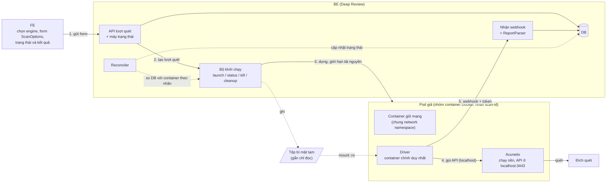

# Tích hợp Acunetix vào Deep Review (bản Docker)

Cho người dùng Deep Review chọn engine **Acunetix**, điền form cấu hình và nhận kết quả quét mà không phải mở giao diện Acunetix. Mỗi lượt quét chạy trong một **pod giả**: một nhóm container Docker dùng một lần, thay cho pod OpenShift. Luồng và thành phần giữ như kế hoạch OpenShift; chỉ lớp khởi chạy được thay bằng Docker để sau này chuyển sang OpenShift mà không phải viết lại phần còn lại.

## Kiến trúc tổng thể

Cách hoạt động, ngắn gọn:

1. FE gửi form tới BE. BE kiểm tra ScanOptions, lưu phần thường vào DB, và đặt phần bí mật (tài khoản, token webhook, thông tin đăng nhập đích) vào tệp tạm theo lượt.
2. BE chỉ nói chuyện với **giao diện bộ khởi chạy** (`launch`, `status`, `kill`, `cleanup`). Bản Docker nằm sau giao diện này; bản OpenShift sẽ thay vào sau.
3. Bộ khởi chạy dựng pod giả: container giữ mạng, container Acunetix (khởi động xong, kiểm tra sẵn sàng), rồi driver. Tất cả chung mạng nên driver gọi Acunetix qua `localhost`.
4. **Driver** là container chính duy nhất. Nó chờ API sẵn sàng, tạo target, cấu hình theo ScanOptions, chạy quét, hỏi trạng thái, kiểm tra sau quét (đăng nhập, độ phủ), lấy hết danh sách lỗi, dọn target, gửi webhook kèm token rồi thoát. Driver thoát thì pod giả kết thúc.
5. BE nhận webhook, dùng ReportParser đổi JSON của Acunetix sang UnifiedReport rồi đặt **trạng thái cuối**. Trạng thái cuối không dựa vào việc container thoát.
6. **Reconciler** lọc container theo nhãn `scan-id`, so với DB để phát hiện pod chết hoặc mất webhook.

## Nguyên tắc thiết kế

- Một lượt quét là một pod giả. Không tự thử lại khi pod lỗi. Trần đồng thời bằng 1; vượt thì từ chối.
- Secret chỉ là tệp tạm gắn chỉ đọc vào driver. Không đi qua biến môi trường, DB, log hay tên container.
- Token webhook ngẫu nhiên mỗi lượt; DB chỉ lưu bản băm. BE không gọi vào pod, driver tự gọi ra.
- Driver thoát mã 50 khi gửi webhook thất bại hết số lần thử.
- Trạng thái: `SCANNING`, `PARSING`, `COMPLETED`, `FAILED`. Mã lỗi: `JOB_LOST`, `CALLBACK_LOST`, `PARSE_FAILED`, `SCAN_TIMEOUT`, `LOGIN_FAILED`, `MANUAL_INTERVENTION`, `LOW_COVERAGE`.

## Đối chiếu với OpenShift

| OpenShift | Docker |
| --- | --- |
| Pod | Nhóm container cùng nhãn `scan-id`, chung mạng |
| Sidecar (Acunetix) | Container chạy nền, có kiểm tra sẵn sàng |
| Container chính (driver) | Container chạy tới khi thoát; mã thoát là tín hiệu |
| Secret của lượt quét | Tệp tạm gắn chỉ đọc vào driver, xóa khi dọn |
| Dọn Job và TTL | Xóa container theo nhãn, giữ log ra tệp trước |
| Hạn tối đa của Job | Reconciler hoặc script dừng container quá hạn |

## Cấu trúc thư mục

| Đường dẫn | Nội dung |
| --- | --- |
| `driver/` | Driver điều khiển Acunetix trong pod giả (client API, cấu hình, log) |
| `scripts/` | Bộ khởi chạy Docker (`pod_manager.py`, `launch.py`, `cleanup.py`) và các script kiểm chứng theo task |
| `docs/PLAN.md` | Kế hoạch: lý do, quyết định đã chốt, trạng thái và mã lỗi |
| `docs/TASKS.md` | Danh sách task T0.x đến T5.x và tiêu chí xong |
| `docs/PROGRESS.md` | Nhật ký tiến độ và bằng chứng từng task |
| `docs/acunetix-api-sequence.md` | Chuỗi gọi API Acunetix đã kiểm chứng |
| `docs/samples/` | JSON mẫu lấy từ chạy thật |
| `tmp/` | Dữ liệu tạm theo lượt quét (không commit) |
