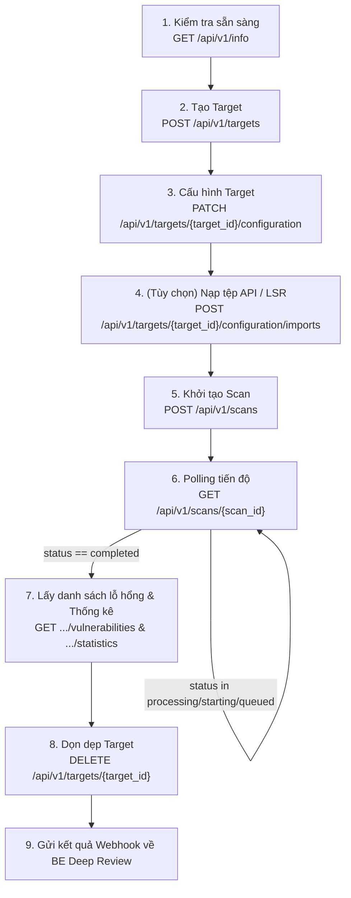

# Đặc tả chuỗi gọi API Acunetix (Acupayload Specification cho Driver)

Tài liệu này tổng hợp toàn bộ các lời gọi API với tên trường thật, cấu trúc JSON và mã trạng thái chuẩn, trích xuất trực tiếp từ bản dựng Acunetix `24.4.240514098` và đã được kiểm chứng chạy thật.

## 1. Thông tin xác thực và Header chung

Tất cả các lời gọi API đều sử dụng HTTPS tới địa chỉ nội bộ của Acunetix (trong pod giả là `https://localhost:3443/api/v1`).

### Header bắt buộc:
```http
X-Auth: <API_KEY>
Content-Type: application/json
Accept: application/json
```
*Lưu ý: API Key là chuỗi hex 65 ký tự được tạo tự động khi khởi tạo instance.*

---

## 2. Chuỗi các bước gọi API tuần tự của Driver



---

## 3. Chi tiết từng API Endpoint

### Bước 1: Kiểm tra sẵn sàng (Healthcheck)
- **Method / URL**: `GET /api/v1/info`
- **Mục đích**: Xác nhận Acunetix opsrv và PostgreSQL đã sẵn sàng nhận lệnh.
- **Phản hồi 200 OK**:
  ```json
  {
    "build_number": "240514098",
    "license": {
      "activated": true,
      "expired": false,
      "expires": "2123-09-19T11:14:10"
    }
  }
  ```

---

### Bước 2: Tạo Target (Scan Target)
- **Method / URL**: `POST /api/v1/targets`
- **Request Body**:
  ```json
  {
    "address": "http://target-app:3000",
    "description": "Scan run by Deep Review - Scan ID: scan-12345",
    "criticality": 10
  }
  ```
- **Phản hồi 201 Created**:
  ```json
  {
    "target_id": "bb2ae47b-cec1-4d8d-bd14-d88f52c559a0",
    "address": "http://target-app:3000",
    "description": "Scan run by Deep Review - Scan ID: scan-12345",
    "criticality": 10
  }
  ```

---

### Bước 3: Cấu hình Target (Target Configuration)
- **Method / URL**: `PATCH /api/v1/targets/{target_id}/configuration`
- **Request Body**:
  ```json
  {
    "scan_speed": "fast",
    "limit_crawler_scope": true,
    "user_agent": "Mozilla/5.0 (Windows NT 10.0; Win64; x64) DeepReview/1.0",
    "custom_headers": [
      "Authorization: Bearer my-secret-token",
      "X-Custom-Header: value1"
    ],
    "excluded_paths": [
      "/logout",
      "/auth/signout",
      "/admin/delete"
    ],
    "login": {
      "kind": "automatic",
      "credentials": {
        "enabled": true,
        "username": "admin@example.com",
        "password": "SecretPassword123"
      }
    }
  }
  ```
  *Lưu ý:*
  - Nếu không đăng nhập: `"login": {"kind": "none"}`
  - `custom_headers` là mảng string `HeaderName: HeaderValue`.
- **Phản hồi**: `204 No Content`

---

### Bước 4: Nạp tệp nhập (OpenAPI, Postman, Swagger hoặc LSR)
- **Nạp API Definition**: `POST /api/v1/targets/{target_id}/configuration/imports`
- **Nạp Login Sequence (.lsr)**: `POST /api/v1/targets/{target_id}/configuration/login_sequence`

---

### Bước 5: Bắt đầu quét (Trigger Scan)
- **Method / URL**: `POST /api/v1/scans`
- **Request Body**:
  ```json
  {
    "target_id": "bb2ae47b-cec1-4d8d-bd14-d88f52c559a0",
    "profile_id": "11111111-1111-1111-1111-111111111111",
    "schedule": {
      "disable": false,
      "start_date": null,
      "time_sensitive": false
    }
  }
  ```
  *Các `profile_id` chuẩn:*
  - Full Scan: `11111111-1111-1111-1111-111111111111`
  - Critical / High Risk: `11111111-1111-1111-1111-111111111112`
  - Critical / High / Medium Risk: `11111111-1111-1111-1111-111111111119`
  - Crawl Only: `11111111-1111-1111-1111-111111111117`
  - SQL Injection: `11111111-1111-1111-1111-111111111113`
  - Cross-site Scripting: `11111111-1111-1111-1111-111111111116`
  - OWASP Top 10: `11111111-1111-1111-1111-111111111129`

- **Phản hồi 201 Created**:
  Header `Location: /api/v1/scans/{scan_id}` chứa `scan_id`.

---

### Bước 6: Hỏi tiến độ quét (Polling)
- **Method / URL**: `GET /api/v1/scans/{scan_id}`
- **Phản hồi 200 OK**:
  ```json
  {
    "scan_id": "5f3a0937-29ab-476f-a89e-2dc7a7182283",
    "target_id": "bb2ae47b-cec1-4d8d-bd14-d88f52c559a0",
    "manual_intervention": false,
    "current_session": {
      "scan_session_id": "5849df74-e381-4279-88b0-516e9112920f",
      "status": "processing",
      "progress": 45,
      "severity_counts": {
        "critical": 1,
        "high": 3,
        "medium": 5,
        "low": 2,
        "info": 10
      }
    }
  }
  ```
- **Máy trạng thái Acunetix**:
  - Đang chạy: `scheduled` -> `queued` -> `starting` -> `processing`
  - Hoàn tất: `completed`
  - Lỗi: `failed`, `aborted`
  - Kiểm tra điều kiện lỗi đặc biệt:
    - Nếu `manual_intervention == true` -> Báo lỗi `MANUAL_INTERVENTION`.
    - Quá thời hạn (timeout) -> Gọi `POST /api/v1/scans/{scan_id}/abort` và báo `SCAN_TIMEOUT`.

---

### Bước 7: Lấy kết quả lỗi & Thống kê
- **Lấy danh sách lỗi**:
  `GET /api/v1/scans/{scan_id}/results/{scan_session_id}/vulnerabilities?l=100`
  *Hỗ trợ phân trang bằng cursor `?c=<cursor>&l=100`.*
  ```json
  {
    "vulnerabilities": [
      {
        "vuln_id": "3141592653589793238",
        "vt_name": "SQL Injection",
        "severity": 3,
        "affects_url": "http://target-app:3000/rest/products/search?q=apple",
        "affects_detail": "q",
        "confidence": 100,
        "status": "open"
      }
    ],
    "pagination": {
      "count": 1,
      "cursor_hash": "...",
      "cursors": [null]
    }
  }
  ```
- **Lấy thống kê thu thập (độ phủ crawl)**:
  `GET /api/v1/scans/{scan_id}/results/{scan_session_id}/statistics`
  - Đọc số trang / đường dẫn thu thập để phát hiện `LOW_COVERAGE` hoặc `LOGIN_FAILED`.

---

### Bước 8: Dọn dẹp Target
- **Method / URL**: `DELETE /api/v1/targets/{target_id}`
- **Phản hồi**: `204 No Content`
- Xóa sạch target và mọi scan liên quan trên Acunetix trước khi container kết thúc.
